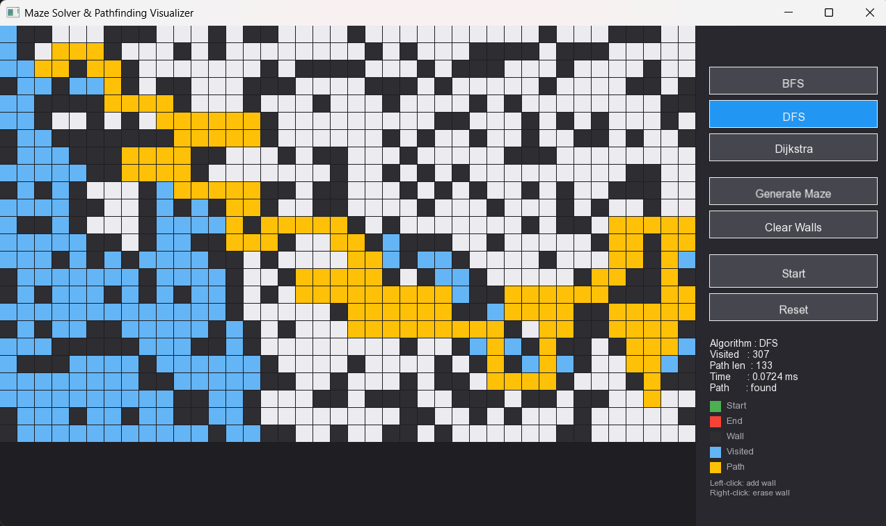

# Maze Solver & Pathfinding Visualizer

A C++17 / SFML desktop application that visualizes three classic graph-traversal
algorithms — **BFS**, **DFS**, and **Dijkstra** — solving a maze step by step.
Built as a university-level Data Structures & Algorithms mini-project.

## Features

- 40 × 24 grid maze with a fixed start (green) and end (red) cell.
- Left-click to draw walls, right-click to erase them.
- Three algorithms implemented from scratch using their canonical structures:
  - **BFS** — `std::queue`, level-by-level, shortest path on unweighted grids.
  - **DFS** — iterative `std::stack`, deep exploration with backtracking.
  - **Dijkstra** — `std::priority_queue` with distance table and parent tracking.
- Smooth, non-blocking animation of the exploration frontier and the final path.
- Performance statistics: visited nodes, path length, execution time (ms),
  and whether a path was found.
- Random maze generation that is *guaranteed* to be solvable.

## DSA Concepts Demonstrated

| Concept                  | Where it appears                                |
|--------------------------|-------------------------------------------------|
| 2-D array / grid graph   | `Maze::grid_`, `Maze::neighbors()`              |
| Queue                    | `Algorithms::runBFS`                            |
| Stack                    | `Algorithms::runDFS`                            |
| Priority Queue           | `Algorithms::runDijkstra`                       |
| Visited set              | `visited` / `closed` boolean grids              |
| Parent tracking          | `parent` 2-D array in every algorithm           |
| Path reconstruction      | `reconstruct()` helper                          |
| Graph traversal          | All three algorithms                            |

## Build (Windows, MSVC)

```bash
# 1. Install SFML 2.6.x to C:\SFML (see top-level instructions).
# 2. From the project root:
cmake -S . -B build -G "Visual Studio 17 2022" -A x64
cmake --build build --config Release
# 3. Run:
build\Release\MazeSolver.exe
```

## Controls

| Action                  | Effect                                   |
|-------------------------|------------------------------------------|
| **BFS / DFS / Dijkstra**| Select the algorithm to run              |
| **Generate Maze**       | New random solvable maze                 |
| **Clear Walls**         | Remove every wall, keep start & end      |
| **Start**               | Run the selected algorithm with animation|
| **Reset**               | Clear the visualization, keep the maze   |
| Left-click / drag       | Add wall                                 |
| Right-click / drag      | Erase wall                               |

## Screenshot




