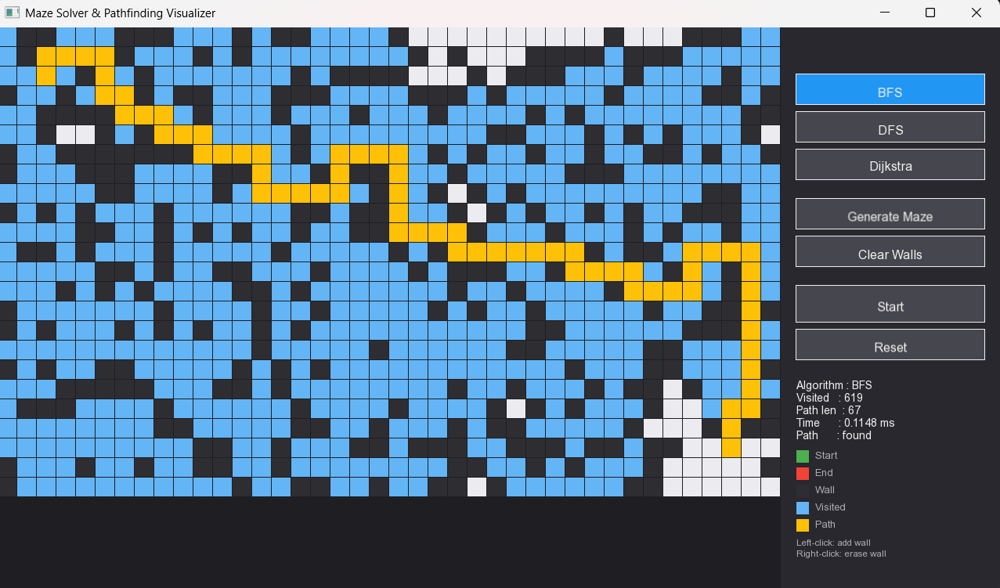
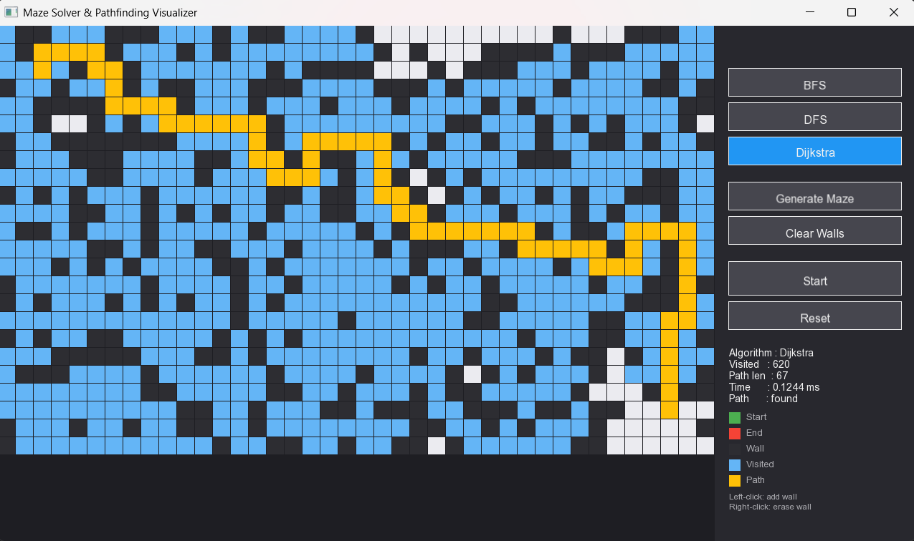

# Maze Solver & Pathfinding Visualizer

A C++17 and SFML-based desktop application that visualizes three classic graph traversal and pathfinding algorithms — **Breadth First Search (BFS), Depth First Search (DFS), and Dijkstra's Algorithm** — solving a maze step by step.

Built as a university-level Data Structures and Algorithms mini-project.

## Overview

The application represents a maze as a 2D grid and demonstrates how different algorithms explore the grid to find a path between a fixed starting point and destination.

Users can create obstacles, generate random solvable mazes, select an algorithm, and watch its exploration process through real-time animation.

## Features

- 40 × 24 grid-based maze.
- Fixed starting point (green) and destination (red).
- Left-click and drag to create walls.
- Right-click and drag to erase walls.
- Three pathfinding algorithms implemented from scratch:
  - **BFS:** Uses `std::queue` to explore cells level by level and find the shortest path.
  - **DFS:** Uses iterative `std::stack` traversal to explore paths deeply before backtracking.
  - **Dijkstra:** Uses `std::priority_queue` and distance tracking to find the shortest path.
- Smooth, non-blocking pathfinding animation.
- Random maze generation with guaranteed solvability.
- Performance statistics:
  - Number of visited nodes.
  - Final path length.
  - Execution time (milliseconds).
  - Whether a path was found.
- Reset and clear maze functionality.

## DSA Concepts Demonstrated

| Data Structure / Concept | Implementation |
|---|---|
| 2D Array | Maze representation |
| Graph | Grid-based graph |
| Queue | BFS |
| Stack | DFS |
| Priority Queue | Dijkstra |
| Visited Array | Tracks explored cells |
| Parent Array | Tracks previous cells |
| Path Reconstruction | Reconstructs the final path |

## Algorithm Complexity

Let V represent the number of vertices (grid cells) and E represent the number of edges (valid connections between adjacent cells).

| Algorithm | Time Complexity | Space Complexity |
|---|---|---|
| BFS | O(V + E) | O(V) |
| DFS | O(V + E) | O(V) |
| Dijkstra | O((V + E) log V) | O(V) |

## Technologies Used

- **Language:** C++17
- **Graphics:** SFML 2.6.x
- **Build System:** CMake
- **IDE:** Visual Studio Code

## Project Structure

```text
Maze_Solver/
│
├── include/
│   ├── Maze.h
│   ├── Algorithms.h
│   └── Visualizer.h
│
├── src/
│   ├── main.cpp
│   ├── Maze.cpp
│   ├── Algorithms.cpp
│   └── Visualizer.cpp
│
├── CMakeLists.txt
├── README.md
└── .gitignore
```

## Installation (Windows)

### Requirements

1. **C++17 Compiler:** Visual Studio 2022 with the Desktop Development with C++ workload.
2. **CMake:** Version 3.16 or higher.
3. **SFML:** Version 2.6.x (64-bit MSVC package).

### SFML Setup

1. Download SFML 2.6.x from https://www.sfml-dev.org/download.php
2. Extract the package to `C:\SFML`.
3. Ensure the folder contains `include`, `lib`, and `bin` directories.

## Build and Run

Open a terminal in the project root directory.

```bash
cmake -S . -B build -G "Visual Studio 17 2022" -A x64

cmake --build build --config Release
```

Run the application:

```bash
build\Release\MazeSolver.exe
```

Make sure the required SFML DLL files are available when running the executable.

## Controls

| Action | Function |
|---|---|
| BFS / DFS / Dijkstra | Select pathfinding algorithm |
| Generate Maze | Generate a new random solvable maze |
| Clear Walls | Remove all walls |
| Start | Execute the selected algorithm |
| Reset | Clear visualization while preserving the maze |
| Left-click / Drag | Add walls |
| Right-click / Drag | Remove walls |

## Screenshots

### BFS Visualization



### DFS Visualization


### Dijkstra Visualization



## Project Purpose

This project demonstrates practical applications of graph traversal, searching, queues, stacks, priority queues, and path reconstruction through an interactive graphical application.

It also allows comparison of different pathfinding approaches based on their exploration behavior and performance statistics.
